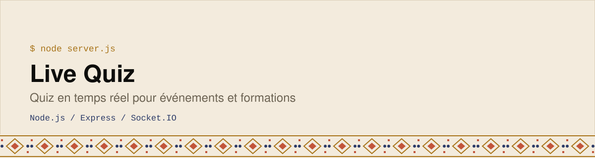
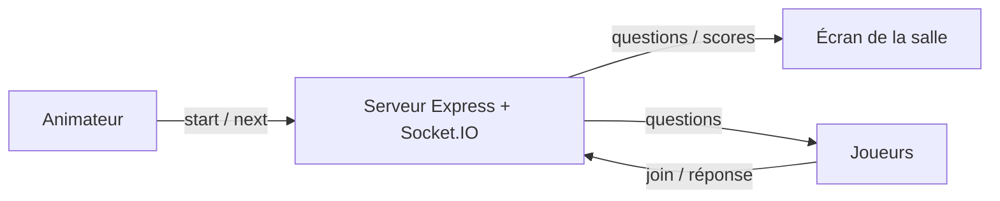

<div align="center">
  <picture>
    <source media="(prefers-color-scheme: dark)" srcset="assets/banner-dark.svg">
    
  </picture>
</div>

Application de quiz **en temps réel** : un animateur lance la partie, les participants répondent depuis leur téléphone et un grand écran affiche le jeu. Conçue pour l’événement [Digital Day](https://github.com/BinaryMaoGenius/digital_day).

   

## Trois interfaces
| Interface | Route | Rôle |
|---|---|---|
| **Animateur** | `/admin/:gameId` | Démarrer, passer à la question suivante, réinitialiser |
| **Joueur** | `/player/:gameId` | Rejoindre avec un pseudo et un avatar, répondre |
| **Écran** | `/screen/:gameId` | Affichage pour la salle |

Une partie est créée via `/api/game/create`, et un **QR code** permet aux joueurs de la rejoindre. Les questions (15 actuellement) sont dans `questions.json`.



## Lancer le projet
```bash
npm install
node server.js     # http://localhost:3000
```
Un fichier `render.yaml` est fourni pour un déploiement sur Render.

## Licence

Code sous [licence MIT](./LICENSE) · © 2026 Emmanuel Elisé Koné.

---

Construit par **Emmanuel Elisé Koné** ([BinaryMaoGenius](https://github.com/BinaryMaoGenius)) · *La tech en clair*
